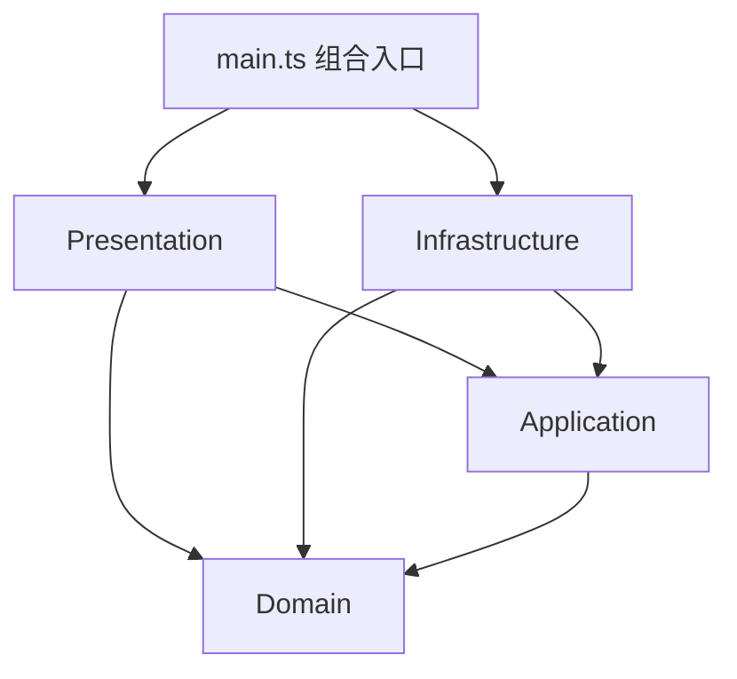

# SVG Editor

一个使用 TypeScript 和面向对象设计实现的命令行 SVG 编辑器。项目支持创建、读取、编辑和保存 SVG 文档，并通过 Command 模式提供完整的 undo/redo 历史。

## Git 仓库

[https://github.com/onlyoneee/svg-editor](https://github.com/onlyoneee/svg-editor)

## 主要功能

- 支持 `rect`、`circle`、`ellipse`、`line`、`text`、`g` 六种 SVG 图形。
- 支持多层容器，以及 `create ... in`、`group`、`ungroup`、`addto` 等层级操作。
- 支持移动、缩放、属性修改和同级 z-order 调整。
- 所有编辑命令均可 undo/redo，文档读写和画布修改具有历史屏障。
- 支持 SVG 读取与保存、缺失 ID 自动编号、XML 转义和结构往返。
- 提供 `tree`、`show`、`help` 等命令行显示功能。
- 错误命令不会修改当前模型，错误和警告使用统一输出格式。

## 快速开始

运行环境要求 Node.js 22 或更高版本。

```bash
git clone https://github.com/onlyoneee/svg-editor.git
cd svg-editor
npm install
npm run cli
```

启动后会显示：

```text
svg-editor 0.1 — type 'help' for commands
svg>
```

示例会话：

```text
svg> init 400 200
canvas 400x200 created
svg> create g flow
g#flow created
svg> create rect start 30 70 120 60 #4a90d9 in flow
rect#start created in g#flow
svg> create text label 55 105 "开始" in flow
text#label created in g#flow
svg> tree
svg (400x200)
└── g#flow
    ├── rect#start x=30 y=70 w=120 h=60 fill=#4a90d9
    └── text#label (55,105) "开始"
svg> save demo.svg
saved to demo.svg (3 elements)
svg> exit
```

`demo.svg` 会保存到启动 CLI 时所在的目录，可直接用浏览器打开。

## 模块划分

```text
src/
├── domain/          # SVG 文档、图形类层次、容器关系和领域约束
├── application/     # 编辑命令、undo/redo 历史和文档会话
├── infrastructure/  # SVG 解析、序列化和文件系统适配
├── presentation/    # CLI、参数解析、输出及 tree/show 格式化
└── main.ts          # 依赖装配和程序入口
```



依赖方向遵循以下规则：

- `domain` 不依赖外层模块。
- `application` 只依赖领域模型。
- `presentation` 依赖应用层和只读领域对象，不直接访问文件系统或 XML 库。
- `infrastructure` 实现应用层定义的 `DocumentStore` 端口。
- `main.ts` 作为组合入口负责创建并连接具体实现。

项目包含自动架构测试，新增反向依赖会导致测试失败。

## 设计模式

### Command

每个编辑动作对应一个实现 `execute()` 和 `undo()` 的命令类。`CommandHistory` 维护 undo/redo 栈，并确保一条用户命令对应一个撤销单元。

具体命令包括：

- `CreateCommand`、`DeleteCommand`
- `MoveCommand`、`ScaleCommand`、`SetCommand`
- `FrontCommand`、`BackCommand`
- `AddToCommand`、`GroupCommand`、`UngroupCommand`

### Composite

抽象类 `Shape` 为叶子图形和 `Group` 提供统一操作。`Group` 递归传播移动、缩放和几何快照，因此调用方无需区分单个图形与容器。

项目还使用：

- **Factory**：集中创建六种具体图形。
- **Memento**：精确恢复移动和缩放前的几何状态。
- **Visitor**：实现 SVG 序列化及图形显示格式化。
- **Registry**：完成 CLI 命令名到命令处理器的分派。

## 开发流程

项目按阶段开发，每个阶段都有独立提交、验收目标和文档记录：

1. **项目骨架和工程规则**：初始化严格模式 TypeScript、构建、测试和格式检查。
2. **领域模型**：实现六种图形、Composite、全局 ID 索引及父子关系。
3. **SVG 读写**：实现解析、序列化、自动 ID、XML 转义和往返测试。
4. **Command 和历史**：实现全部编辑命令、undo/redo、Memento 和历史屏障。
5. **命令解析和 CLI**：实现 tokenizer、命令注册表、参数检查及显示命令。
6. **集成测试**：通过真实 CLI 子进程覆盖完整用户会话和错误原子性。
7. **文档和一致性检查**：完成架构记录、依赖审查和自动架构测试。
8. **提交整理和交付**：运行完整门禁、推送提交并用 `final` tag 标记最终版本。

过程记录从首次提交开始持续更新。详细的架构决策、问题修正和各阶段提交记录见 [doc/README.md](doc/README.md)。

## 质量保证

```bash
npm run build         # 严格模式编译生产代码
npm test              # 编译并运行全部单元与集成测试
npm run format:check  # 检查代码和文档格式
npm run check         # 顺序运行以上全部门禁
```

当前测试覆盖：

- 六种图形及属性白名单。
- 多层容器的递归移动和缩放。
- 全局重复 ID、父子循环和顺序约束。
- 每种编辑命令的 undo/redo。
- SVG 解析、保存、自动 ID 和 XML 特殊字符。
- CLI 引号、空格、中文和转义字符。
- 文件异常、错误原子性和完整 transcript。
- 源码模块的依赖方向。

## CLI 命令概览

| 类别       | 命令                                         |
| ---------- | -------------------------------------------- |
| 文档       | `init`、`read`、`save`、`canvas`             |
| 创建与删除 | `create`、`delete`                           |
| 几何与属性 | `move`、`scale`、`set`                       |
| 层级与顺序 | `group`、`ungroup`、`addto`、`front`、`back` |
| 历史       | `undo`、`redo`                               |
| 查看       | `tree`、`show`、`help`                       |

在 CLI 中执行 `help` 可以查看每条命令的完整语法。
