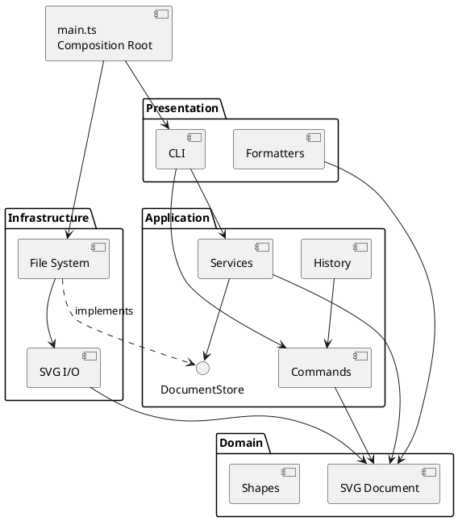

# SVG 编辑器架构与开发记录

本文档从项目骨架阶段开始随代码共同演进。当前已完成领域模型、SVG 读写、Command 历史、完整 CLI、集成测试和架构一致性检查。

## 架构方案

### 模块划分

| 模块     | 目录                 | 职责                                     |
| -------- | -------------------- | ---------------------------------------- |
| 领域模型 | `src/domain`         | SVG 文档、图形类层次、容器关系和领域约束 |
| 应用层   | `src/application`    | 编辑命令、Command 历史和应用服务         |
| 基础设施 | `src/infrastructure` | SVG 解析与序列化、文件系统适配           |
| 表现层   | `src/presentation`   | CLI、命令行输出和树形/明细格式化         |
| 组合入口 | `src/main.ts`        | 创建具体实现并启动应用                   |



### 设计模式的选择

- **Command**：每条可撤销编辑命令实现统一的 `execute`/`undo` 协议；`CommandHistory` 管理 undo/redo 栈。一条用户命令对应一个原子撤销单元。
- **Composite**：叶子图形和 `g` 容器通过统一图形抽象参与移动、缩放、删除和属性设置。容器负责把适用操作递归传递给子孙。
- **Factory**：图形类型名到具体类的映射集中在一个工厂。它是需求允许的两处按名称分派之一，后续插件化阶段再替换为注册机制。
- **Memento**：移动和缩放命令在执行前捕获图形几何状态；容器的 Memento 组合其全部子孙状态，避免用逆运算撤销时产生浮点误差。
- **Registry**：CLI 通过命令注册表完成命令名到处理器的分派，新增命令只需实现统一接口并在组合根注册。
- **Visitor**：SVG 序列化和 CLI 图形格式化都通过图形 Visitor 获取具体类型数据，使展示逻辑无需按标签名分派。

上述模式均已在对应模块落地。命令名分派只存在于 `CommandRegistry`，图形类型到具体类的分派只存在于 `ShapeFactory`。

#### Command 的具体落点

| Command 角色     | 代码位置                                                                                                                                                       | 落地方式                                               |
| ---------------- | -------------------------------------------------------------------------------------------------------------------------------------------------------------- | ------------------------------------------------------ |
| Command 接口     | `src/application/commands/EditCommand.ts`                                                                                                                      | 统一声明 `execute()` 和 `undo()`                       |
| Concrete Command | `CreateCommand`、`DeleteCommand`、`MoveCommand`、`ScaleCommand`、`SetCommand`、`FrontCommand`、`BackCommand`、`AddToCommand`、`GroupCommand`、`UngroupCommand` | 每个编辑动作一类一文件，保存自身撤销所需状态           |
| Invoker          | `src/application/history/CommandHistory.ts`                                                                                                                    | 执行命令并维护 undo/redo 栈，成功执行新命令后清空 redo |
| Receiver         | `SvgDocument`、`Shape` 及具体图形类                                                                                                                            | 真正执行增删、移动、缩放、属性和顺序规则               |
| Client / Adapter | `src/presentation/cli/commands/*CliCommand.ts`                                                                                                                 | 解析 CLI 参数，构造应用层 Command 并交给历史执行       |
| 历史边界         | `src/application/services/DocumentSession.ts`                                                                                                                  | init/read/save/canvas 成功后建立历史屏障               |

表现层的 `CliCommand` 负责“用户输入到应用调用”的适配；应用层的 `EditCommand` 才是可撤销的 Command。两者名称接近但职责和生命周期不同。

#### Composite 的具体落点

| Composite 角色 | 代码位置                                    | 落地方式                                                                   |
| -------------- | ------------------------------------------- | -------------------------------------------------------------------------- |
| Component      | `src/domain/shapes/Shape.ts`                | 为叶子和容器统一定义 `move`、`scale`、`set`、Memento、Visitor 和树遍历协议 |
| Leaf           | `Rect`、`Circle`、`Ellipse`、`Line`、`Text` | 各自封装几何字段和属性白名单                                               |
| Composite      | `src/domain/shapes/Group.ts`                | 保存子节点，并将移动、缩放和几何快照递归作用于子孙                         |
| 聚合根         | `src/domain/document/SvgDocument.ts`        | 维护根顺序、父子位置和全局 ID 索引，统一接受叶子或容器子树                 |
| 一致性协作     | `src/domain/shapes/ShapeOwner.ts`           | 组在已挂载文档中增删子树时同步全局索引                                     |

编辑命令只依赖 `Shape`/`SvgDocument` 的统一操作，不需要按叶子或容器分别实现。删除容器、移动容器和缩放容器因此保持同一命令语义。

### 依赖方向规则

1. `domain` 不依赖应用层、基础设施层或表现层。
2. `application` 可以依赖 `domain`，不能依赖具体 CLI、XML 库或文件系统实现。
3. `presentation` 可以依赖 `application` 和只读的领域抽象，不能直接调用基础设施实现。
4. `infrastructure` 实现应用层定义的端口，并可依赖 `domain`。
5. `main.ts` 是组合根，可以依赖所有模块，业务逻辑不得放在此处。
6. 命令名分派只出现在 CLI 命令注册处；图形类型名分派只出现在图形工厂。

依赖方向的目标是使图形规则和编辑命令可以脱离终端、文件系统及具体 XML 库进行测试。

### 变化点假设

| 可能变化                         | 当前预留                                     |
| -------------------------------- | -------------------------------------------- |
| 新增图形类型                     | 图形类层次和集中式工厂；插件注册留到后续阶段 |
| 新增 CLI 命令或其他交互通道      | 命令对象与表现层分离；CLI 使用命令注册点     |
| 替换 XML 解析库                  | SVG 读写限制在 `infrastructure/svg`          |
| 替换本地文件系统                 | 文件访问限制在 `infrastructure/filesystem`   |
| 输出到终端、测试缓冲区或其他界面 | 表现层通过 `Output` 接口输出                 |
| 撤销策略变化                     | 历史职责集中在 `application/history`         |
| XML 库或文件存储方式变化         | `DocumentStore` 端口隔离应用层与具体实现     |

当前不为网络协作、GUI 和插件动态加载实现扩展框架，因为这些内容不属于 Phase 1 的交付范围。

## 过程记录

### AI 协作方式

用户按阶段给出目标和可验收行为，AI 在每一阶段先检查已有代码和前一阶段约束，再实现、运行门禁、更新本文档并创建独立提交；用户在阶段之间通过本地 CLI 运行和远程推送继续验收。架构说明没有在最后集中补写：`git log --follow -- doc/README.md` 可看到本文档从首次骨架提交起随每个阶段持续修改。

协作中保留了以下有代表性的复核和修正：

| 阶段     | 初始判断或风险                                    | 复核后的处理                                            |
| -------- | ------------------------------------------------- | ------------------------------------------------------- |
| 领域模型 | 允许直接修改已挂载的 `Group` 会使文档 ID 索引失步 | 增加 `ShapeOwner` 协作协议，并用索引同步测试固定行为    |
| SVG 读写 | 若边解析边替换当前文档，失败可能留下半份新文档    | 先完整构建候选文档，成功后由 `DocumentSession` 一次替换 |
| Command  | 用逆运算实现 scale undo 会积累浮点误差            | 改用递归 `GeometryMemento` 精确恢复原值                 |
| 历史     | 失败的新命令若提前清空 redo，会破坏已有历史       | 命令成功后才入栈和清空 redo，并补失败场景测试           |
| CLI      | 把 `#` 当行内注释会截断 `#ffffff` 颜色            | 只接受去除前导空白后以 `#` 开头的整行注释               |
| 集成测试 | 只断言成功消息无法证明失败命令没有部分修改        | 在错误前后比较完整 `tree` 快照，并用真实子进程回放      |

### 阶段 1：项目骨架

- 仓库开始时为空，只有 Git 元数据和远程地址。
- 选择 TypeScript 严格模式，尽早发现未处理的空值、错误类型和大小写问题。
- 测试使用 Node 内置测试运行器，避免为当前规模引入额外测试框架。
- 输出经由 `Output` 接口，`ConsoleOutput` 统一添加 `warning:` 和 `error:` 前缀；成功反馈和显示内容不添加前缀。
- CLI 当前只实现启动、注释/空行忽略和安全退出。业务命令将在后续阶段实现。

### 阶段 2：领域模型

- 以 `Shape` 抽象类集中实现移动、缩放及公共样式属性的入口校验，六种图形类分别封装自身几何字段和属性白名单。
- `Group` 与叶子图形共享同一抽象，并递归移动、缩放子孙，形成 Composite。
- `SvgDocument` 作为聚合根维护画布、根节点顺序和全局 ID 索引；所有新增子树均先完整检查重复 ID，再修改结构。
- 初版设计允许直接修改已挂载的 `Group`，但这会让文档索引失步。复核后增加 `ShapeOwner` 协议，让容器增删子树时同步注册或注销索引，并用测试固定该约束。
- 父子移动先检查目标是否位于待移动容器的子树中，再摘除原节点，保证循环关系错误不会造成部分修改。
- 删除子树会保留其内部父子结构，并返回原父容器和位置，供后续 Command 撤销恢复使用。

### 阶段 3：SVG 读写

- `SvgSerializer` 使用 Visitor 对六种图形进行多态序列化，没有新增按标签名判断的分派点；输出包含 XML 声明、SVG 命名空间、画布和 `viewBox`。
- `SvgParser` 使用保序 XML 解析结果重建图形树。所有显式 ID 会先被收集，缺失 ID 再按标签编号，因此自动生成的 ID 不会与文件后部的显式 ID 冲突。
- 属性值和 text 内容分别使用对应的 XML 转义规则；读取时由 XML 解析器还原实体。
- `DocumentSession` 先让 `DocumentStore` 完整读取候选文档，成功后才替换当前文档和路径。文件不存在、XML 非法或模型校验失败时，旧状态保持不变。
- 当前领域模型无法无损表达 `path`、任意 SVG 属性、复杂 `viewBox` 和 `transform`。解析器对此明确报错，避免保存时静默丢失内容或改变视觉结果。该范围与 Phase 1 的六种内置图形一致。
- 拒绝 `DOCTYPE` 和自定义实体，只接受标准 XML 实体，避免把 SVG 读取变成外部实体或文档类型处理入口。

### 阶段 4：Command 和历史

- 每个编辑操作均为独立 Command 类，实现 `execute` 和 `undo`。`create`、`delete`、`move`、`scale`、`set`、`front`、`back`、`addto`、`group`、`ungroup` 已全部覆盖。
- `CommandHistory` 在命令成功后才写入 undo 栈。失败命令不进入历史，也不会清空已有 redo 栈；undo 后的新编辑成功时才清空 redo。
- `SvgDocument` 提供位置快照和按父容器、索引精确复原的能力。删除、层级移动和 z-order 撤销均恢复原父容器与原顺序。
- `group` 在修改前验证全部 ID、重复选择和祖先/子孙冲突，整组操作只占一个历史单元；子图形按照原树顺序进入新组。`ungroup` 同样一次提升或恢复全部直接子节点。
- move/scale 使用几何 Memento 撤销。对 `g` 创建 Memento 时递归捕获子孙，因此小数几何值也能精确恢复。
- `DocumentSession` 在成功的 init/read/save/canvas 修改后清空旧历史并建立屏障。下一条成功编辑解除屏障并开始新的历史段；失败的 I/O 或画布修改不影响现有历史。

### 阶段 5：命令解析和 CLI

- `CommandTokenizer` 逐字符识别双引号参数，支持引号内的转义引号、反斜杠和空字符串；`#` 只在整行开头表示注释，因此 SVG 颜色值不会被误删。
- `CommandRegistry` 是唯一的命令名分派点。19 条文档、编辑、显示和历史命令均实现同一 `CliCommand` 接口，由 `main.ts` 统一装配。
- `CliArguments` 统一检查参数数量和有限数值；`create` 仅在参数尾部识别 `in <containerId>`，六种图形的参数到具体类型转换继续集中在 `ShapeFactory`。
- `tree` 和 `show` 共享基于 Visitor 的图形格式化器，支持嵌套树、父容器、几何属性、文本和公共样式显示。
- CLI 在单条命令边界捕获错误并经 `Output` 输出，失败后继续处理下一行。读入 SVG 的自动 ID 信息沿同一接口输出为 `warning:`。
- 端到端测试用真实 Node 子进程回放典型会话，覆盖注释、引号、颜色、全部命令类型、历史屏障、读写文件和失败后继续执行。

### 阶段 6：集成测试

- 集成测试直接启动编译后的 CLI 子进程，输入与真实用户相同的逐行命令，并检查 stdout、stderr、`tree` 快照和保存文件，避免只验证内部方法调用。
- 对十种编辑命令分别记录执行前、执行后、undo 后和 redo 后的 `tree`。测试要求 undo 后与原快照完全相等、redo 后与执行结果完全相等，同时检查关键几何值和兄弟顺序。
- 六种图形在同一会话中完成创建、`tree`/`show` 显示和保存；text 覆盖空格、中文、引号及 XML 特殊字符，保存结果再经 XML 校验器验证。
- 多层 `create ... in`、容器递归移动/缩放、删除整棵子树、`group`/`ungroup`/`addto` 的顺序恢复，以及 `front`/`back` 只影响同级节点均有 CLI 快照断言。
- 对重复 ID、缺失对象、非法数值、非正缩放和失败文件操作，在错误前后比较完整 `tree` 文本，确认失败没有造成部分修改。
- 文件场景覆盖缺失 ID 自动编号与警告、不存在的输入文件、不可写的输出目标，以及失败 I/O 后当前文档和可撤销历史仍可继续使用。

| 用户可见行为                | 集成验证方式                                    |
| --------------------------- | ----------------------------------------------- |
| 六种图形、Unicode、XML 转义 | CLI 创建并保存，检查显示、SVG 元素和 XML 合法性 |
| 每种编辑命令的 undo/redo    | 四次 `tree` 快照做执行、撤销、重做对称比较      |
| 容器和顺序操作              | 比较嵌套树、几何值和兄弟节点出现顺序            |
| 错误原子性                  | 每条错误命令后重新执行 `tree` 并与基准严格相等  |
| I/O 和历史屏障              | 检查错误输出、自动 ID 警告和屏障后的 undo 行为  |
| 完整 transcript             | 真实子进程逐行回放需求文档会话                  |

### 阶段 7：文档和一致性检查

- 对照实际源码补充 Command 与 Composite 的参与者、文件位置和调用关系，区分表现层 `CliCommand` 与应用层可撤销 `EditCommand`。
- 复核 PlantUML 与实际装配关系，补入 `main.ts` 组合根、`DocumentStore` 端口，以及文件系统适配器对 SVG 读写组件的依赖。
- 逐层扫描源码 import，并增加 `test/Architecture.test.ts` 自动检查允许的依赖方向。检查覆盖全部 `src` TypeScript 文件，而不只依靠人工抽样。
- 对照最初模块方案记录实现细化和范围决定；顶层四层结构没有偏离，新增内容都位于原定职责内部。

文档演进记录：

| 阶段 | 提交      | 文档随提交记录的内容                      |
| ---- | --------- | ----------------------------------------- |
| 1    | `0e35494` | 初始架构、依赖规则、变化点和质量门禁      |
| 2    | `cfd5b3c` | Composite、全局索引及循环检查的实现决策   |
| 3    | `ac1a6ac` | SVG 往返、自动 ID、原子读取及支持范围     |
| 4    | `4f7fcbe` | Command、Memento、顺序恢复和历史屏障      |
| 5    | `80013ee` | tokenizer、注册表、CLI 格式化和端到端入口 |
| 6    | `9a8abe6` | 用户行为集成矩阵和错误原子性验证          |

## 一致性自查

### 模块划分

实际运行时代码保持最初方案中的四层和一个组合入口：

```text
src/
├── domain/
│   ├── document/
│   ├── errors/
│   └── shapes/
├── application/
│   ├── commands/
│   ├── errors/
│   ├── history/
│   └── services/
├── infrastructure/
│   ├── filesystem/
│   └── svg/
├── presentation/
│   ├── cli/
│   │   └── commands/
│   └── formatters/
└── main.ts
```

顶层模块没有偏离方案。实现过程中出现了三处文件级细化：

1. 领域层增加 `ShapeOwner`，解决已挂载容器变化时的全局 ID 索引同步；增加 `GeometryMemento`，支持递归且精确的几何撤销。这两项仍属于领域约束。
2. 表现层把每条 CLI 命令拆到 `presentation/cli/commands`。它们是参数和输出适配器；真正可撤销的命令仍位于 `application/commands`。
3. 测试位于顶层 `test/`，没有放进任何运行时层。集成测试启动编译后的入口，架构测试读取源码 import，但生产代码不依赖测试。

插件动态加载、复合 `box` 图形、GUI 和网络存储继续按范围决定保留为未来变化点，本阶段没有为其增加空抽象或目录。

### 依赖方向

阶段 7 先用 `rg` 抽样查看关键 import，再由架构测试扫描全部源码。结果如下：

| 抽样点                                                                         | 实际依赖                                       | 结论                               |
| ------------------------------------------------------------------------------ | ---------------------------------------------- | ---------------------------------- |
| `domain/shapes/Shape.ts`、`Group.ts`、`domain/document/SvgDocument.ts`         | 只引用 `domain` 内部类型                       | 符合；领域层不认识外层             |
| `application/commands/GroupCommand.ts`、`history/CommandHistory.ts`            | 引用领域模型或应用层接口                       | 符合；没有 CLI、XML 或文件系统依赖 |
| `application/services/DocumentSession.ts`                                      | 依赖领域文档、历史和 `DocumentStore` 端口      | 符合依赖倒置                       |
| `infrastructure/filesystem/SvgFileStore.ts`                                    | 实现应用端口，组合 `SvgParser`/`SvgSerializer` | 符合；具体 I/O 留在基础设施层      |
| `presentation/cli/commands/CreateCliCommand.ts`、`formatters/TreeFormatter.ts` | 依赖应用命令、服务和领域只读对象               | 符合；没有引用基础设施             |
| `main.ts`                                                                      | 引用并装配全部层                               | 符合组合根例外                     |

`test/Architecture.test.ts` 根据源文件所在层解析相对 import，并执行以下允许矩阵：

| 来源层           | 允许依赖                                  |
| ---------------- | ----------------------------------------- |
| `domain`         | `domain`                                  |
| `application`    | `application`、`domain`                   |
| `infrastructure` | `infrastructure`、`application`、`domain` |
| `presentation`   | `presentation`、`application`、`domain`   |

检查结果为零条违规。`main.ts` 作为组合根不套用单层限制。以后新增源码若反向引用，会直接使 `npm test` 失败。

## 质量保证手段

当前质量门禁为：

1. `npm run build`：使用 TypeScript 严格模式编译生产代码。
2. `npm test`：编译并运行 58 项 Node 测试，其中集成层通过真实 CLI 子进程覆盖六种图形、显示与保存、多层组合、全部编辑命令的 undo/redo、顺序恢复、redo 清空、历史屏障、错误原子性、文件异常、Unicode、XML 特殊字符和完整 transcript；单元层继续覆盖领域不变量和读写细节。
3. `npm run format:check`：验证源码、配置和文档格式。
4. `npm run check`：顺序执行以上全部检查。
5. CLI 端到端检查：以子进程启动程序，逐行回放需求中的典型操作，验证横幅、`svg>` 提示符、输出、错误恢复和 `exit`/`quit` 退出。
6. 架构依赖检查：扫描 `src` 中全部相对 import，对照分层允许矩阵，发现反向依赖时使测试失败。

这些手段分别覆盖静态类型、领域规则、应用历史、SVG 往返、真实 CLI 行为、格式一致性和架构方向。当前门禁没有跳过项，构建及测试不依赖网络服务。
