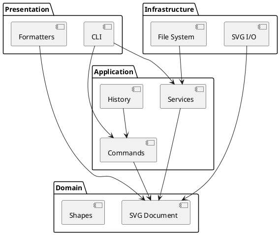

# SVG 编辑器架构与开发记录

本文档随代码共同演进。当前只完成阶段 1 的项目骨架，功能实现将在后续阶段补充。

## 架构方案

### 模块划分

| 模块     | 目录                 | 职责                                     |
| -------- | -------------------- | ---------------------------------------- |
| 领域模型 | `src/domain`         | SVG 文档、图形类层次、容器关系和领域约束 |
| 应用层   | `src/application`    | 编辑命令、Command 历史和应用服务         |
| 基础设施 | `src/infrastructure` | SVG 解析与序列化、文件系统适配           |
| 表现层   | `src/presentation`   | CLI、命令行输出和树形/明细格式化         |
| 组合入口 | `src/main.ts`        | 创建具体实现并启动应用                   |

### 设计模式的选择

- **Command**：每条可撤销编辑命令将实现统一的执行与撤销协议；历史模块管理 undo/redo 栈。一条用户命令对应一个原子撤销单元。
- **Composite**：叶子图形和 `g` 容器通过统一图形抽象参与移动、缩放、删除和属性设置。容器负责把适用操作递归传递给子孙。
- **Factory**：图形类型名到具体类的映射集中在一个工厂。它是需求允许的两处按名称分派之一，后续插件化阶段再替换为注册机制。

阶段 1 只建立模块边界和 CLI 外壳，以上模式将在后续阶段落地。

### 依赖方向规则

1. `domain` 不依赖应用层、基础设施层或表现层。
2. `application` 可以依赖 `domain`，不能依赖具体 CLI、XML 库或文件系统实现。
3. `presentation` 可以依赖 `application` 和只读的领域抽象，不能直接调用基础设施实现。
4. `infrastructure` 实现应用层定义的端口，并可依赖 `domain`。
5. `main.ts` 是组合根，可以依赖所有模块，业务逻辑不得放在此处。
6. 命令名分派只出现在 CLI 命令注册处；图形类型名分派只出现在图形工厂。

依赖方向的目标是使图形规则和编辑命令可以脱离终端、文件系统及具体 XML 库进行测试。

### 变化点假设

| 可能变化                         | 当前预留                                     |
| -------------------------------- | -------------------------------------------- |
| 新增图形类型                     | 图形类层次和集中式工厂；插件注册留到后续阶段 |
| 新增 CLI 命令或其他交互通道      | 命令对象与表现层分离；CLI 使用命令注册点     |
| 替换 XML 解析库                  | SVG 读写限制在 `infrastructure/svg`          |
| 替换本地文件系统                 | 文件访问限制在 `infrastructure/filesystem`   |
| 输出到终端、测试缓冲区或其他界面 | 表现层通过 `Output` 接口输出                 |
| 撤销策略变化                     | 历史职责集中在 `application/history`         |

当前不为网络协作、GUI 和插件动态加载实现扩展框架，因为这些内容不属于 Phase 1 的交付范围。

## 过程记录

### 阶段 1：项目骨架

- 仓库开始时为空，只有 Git 元数据和远程地址。
- 选择 TypeScript 严格模式，尽早发现未处理的空值、错误类型和大小写问题。
- 测试使用 Node 内置测试运行器，避免为当前规模引入额外测试框架。
- 输出经由 `Output` 接口，`ConsoleOutput` 统一添加 `warning:` 和 `error:` 前缀；成功反馈和显示内容不添加前缀。
- CLI 当前只实现启动、注释/空行忽略和安全退出。业务命令将在后续阶段实现。

## 一致性自查

### 模块划分

阶段 1 的目录与架构方案一致。空模块用占位文件纳入 Git，后续加入实现时删除占位文件。

### 依赖方向

阶段 1 中，表现层只依赖自身输出抽象；组合入口负责实例化 CLI。领域层和基础设施层尚无实现，未发现违反依赖规则的引用。

后续每个阶段完成后继续抽样检查 import 方向，并在出现偏差时更新本节和修订记录。

## 质量保证手段

当前质量门禁为：

1. `npm run build`：使用 TypeScript 严格模式编译生产代码。
2. `npm test`：编译并运行 Node 测试，现阶段验证统一输出规则。
3. `npm run format:check`：验证源码、配置和文档格式。
4. `npm run check`：顺序执行以上全部检查。
5. CLI 冒烟检查：启动程序，确认显示横幅与 `svg>` 提示符，并能通过 `exit`、`quit` 或 EOF 正常结束。

功能测试矩阵将在相应命令实现时逐步补充。
